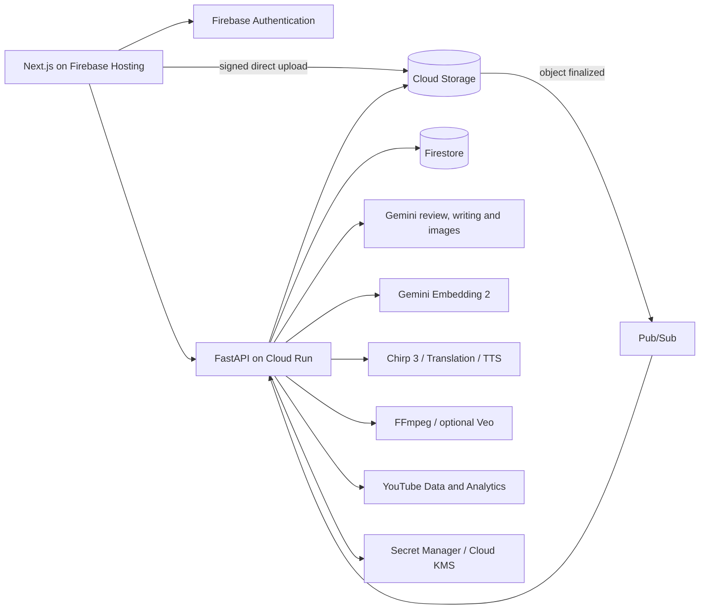

# Resonance Creator Studio

Resonance turns one video upload into an editorial review a creator can check. Nine
specialist Gemini reviewers and a whole-video rubric pass read the transcript and footage.
An editor stage merges what they agree on and drops what does not hold up. The result is a
seekable heatmap under the timeline, where every finding links to the moment, a quoted piece
of evidence, an explanation and a concrete edit. The creator accepts or dismisses each one,
exports a cut list and edit plan, edits in their own editor, uploads a revision, and sees what
was fixed. The same workspace then uses the creator's
earlier work for drafts, thumbnails, localized captions and dubbing, a YouTube package and
scheduled publishing.

**[Live app](https://habeas-codus.web.app)** · [Evidence](evals/README.md) ·
[Architecture](docs/architecture.md) · [Costs](docs/costs.md) ·
[API contract](contracts/openapi.yaml) · [Status and open items](docs/current-progress/HANDOFF.md)

Built for the Google Cloud AI Builder Cup, Media, Content & Digital Experiences theme. The
Google Cloud project and some resource names still use the original name, `habeas-codus`.

## Highlights

- **Why specialized multimodal agents beat dumping everything into one context window.** Across
  **54 unseen pre-registered planted flaws** (11 held-out and long-form videos), the nine
  specialists caught **53/54 (98.1%)** against **45/54 (83.3%)** for a single Gemini prompt
  given the full video, transcript, schema and Search grounding (**8–0 discordant, exact
  two-sided sign test $p = 0.0078$; 9–0 on actionable medium+ issues, $p = 0.0039$**). With the
  editor stage, Resonance keeps **52/54 (96.3%)** on strict dimension matching (**8–1,
  $p = 0.039$**) and **53/54 (98.1%)** on timeline moment matching (**8–0, $p = 0.0078$**). On
  long-form videos (8–12 min) it caught **31/32 (97%) at 91% precision**, beating even a
  mega-prompt with all nine rubrics pasted in (**28/32**, 3–0 discordant) and missing zero
  issues any single-prompt baseline found. [Details](evals/README.md#editorial-review-nine-specialists-versus-one-prompt)
- **Active multimodal inspection and fault isolation, not a fragile mega-prompt.** Instead of
  stuffing an entire raw MP4 and nine competing rubrics into one call, specialists inspect
  bounded transcript windows with shared keyframes and call `extract_frame` and `cut_clip` on
  demand (**1,136 live FFmpeg footage tool calls across 180/180 successful specialist runs** on
  the 20 benchmark videos), while an independent footage adjudicator verifies high/critical
  claims against extracted frames and 10-second clips.
- **Many reviewers without the noise.** Raw multi-reviewer output is 34–41% precise because
  reviewers re-report the same moment through different lenses. The editor stage compresses
  findings by 55–65%, brings precision to **78–91%** on unseen sets it was never tuned on, and
  records cross-reviewer corroboration (`corroboratedBy`) on every merged finding.
- **Proven on real creator mistakes where a single context dump failed.** On four real CC BY
  creator videos with five post-publish creator corrections, Resonance surfaced **4 of 5 (80%)**
  at the exact timestamp (all at actionable `medium` severity; **3/5** under strict
  `truth_evidence`-only dimension matching), matching John Green's Call of Duty franchise fix
  and Sierra Leone `bedaquiline` cohort fix. Its **Cultural & Localization** specialist also
  caught his Ukraine `"borderlands"` (`okraina` vs. `krajina`) etymology mistake (`audience_brand`
  corroborated, `editor-v6` kept) that generalist fact-checking missed. Meanwhile, the single
  all-rubric mega-prompt hit `429 RESOURCE_EXHAUSTED` on the 9-minute Ukraine video and lost the
  entire video (**2/5** overall), and the plain single prompt caught only **2/5** at actionable
  severity. [Set](evals/editorial-real/README.md)
- **Where viewers lean in or drift.** An audience-interest lane, trained on YouTube Most
  Replayed data with Gemini moment signals, predicts where a video rises above or falls
  below the typical drop-off. On 87 unseen creator videos it correlates with the real
  deviations at ρ = 0.15 (95% CI 0.10–0.20), and it can be recalibrated on a creator's own
  YouTube Analytics retention.
- **AI suggests, code enforces, the creator decides.** Nothing is auto-edited. Quotes not found
  in the transcript are rejected in code; every finding pairs evidence with a proposed change,
  accepted removals compile into a CMX3600 cut list plus Markdown notes, and deterministic
  before/after alignment verifies which findings were resolved.
- **Built to be checked.** Typed API and database contracts, provider boundaries around every
  Google call, ownership checks, real deletion, spend guards, and eval runs that replay
  offline from saved model responses.

## The problem

A creator finishing a video has to answer four questions: what is wrong, where, why, and
what to change. Today the answers are spread across tools. A comment says something is wrong
but not where. An AI model returns a score that cannot be opened or checked against the
footage. A clipper cuts moments out of context, and a separate tool rewrites the copy. None
of them remember the creator's earlier work, voice or visual style.

Resonance makes review an inspectable loop. Each warning is tied to a second of video,
backed by a quote or a frame, and paired with an edit the creator can accept or dismiss. The
creator's history is an input in its own right and is kept separate from facts about the
current video.

## What it does

| Workflow | Implemented behavior |
|---|---|
| Review a video | Nine specialist reviewers (truth/evidence, clarity, pacing/retention, legal/safety, cultural/localization, platform fit, audience/brand, emotional impact, conversion/CTA) plus a whole-video rubric pass. Reviewers can request frames or clips through a bounded tool loop, and truth review can use Google Search grounding. An editor merges duplicates and drops weak findings; an adjudicator can check a finding against the footage. A five-second heatmap seeks straight to each moment, and reviewed stretches with nothing to flag show as reviewed, not blank. |
| Close the loop | Accept or revise findings, choose Cut/Note labels and download a CMX3600 cut list or Markdown edit plan from Review. Edit in your own editor, upload a new revision and re-review: a before/after comparison shows what was resolved and what is new. Findings link to related passages from the creator's earlier work. |
| Predict interest | A relative audience-interest curve against the typical drop-off. Its peaks and dips link to overlapping findings, and a creator can calibrate it on their own YouTube retention. |
| Work with the transcript | Chirp 3 word timings and speaker labels, optional Gemini cleanup, editable transcript versions, search, SRT/VTT/text export and source-video revisions. |
| Preserve creator context | A searchable library of attributed passages and thumbnails embedded with Gemini Embedding 2, used for drafts, thumbnail style references and post-review links, with an explorable semantic map. |
| Write and revise | Brief-driven drafts and scripts that use the video's own context, grounded writing chat, editable blocks, version history and inline alternatives. |
| Prepare media | Five caption styles with FFmpeg burn-in; translation, terminology and cultural adaptation, and timed dubbing across a 25-language voice catalog. Thumbnails from source frames and creator references, with critique and revisions. |
| Package and publish | Generated YouTube listings, source-linked visual inserts (local charts and callouts, optional bounded Veo shots), YouTube upload with thumbnail and captions, scheduled publication with clear warnings when a step fails, a content calendar, and cross-posting of written drafts to Substack, Medium and Reddit. |
| Own the workspace | Google sign-in, an editable persona, job progress over WebSocket, project and account deletion, and a read-only public demo. |

## How the review works

The models generate critique and language. Plain code decides what reaches the creator and
how each result is anchored to the source.

1. **Upload and transcribe.** The browser uploads directly to Cloud Storage through a signed
   URL. Upload completion and the Storage `object finalized` Pub/Sub push converge on one
   idempotent transcription job using Chirp 3.
2. **Pin the run.** Analysis pins the asset, transcript and persona version, and splits the
   transcript into windows with overlapping context. Every timeline interval has exactly one
   owning chunk.
3. **Review.** Nine reviewers run over the chunks with shared stills; each may request up to
   three frames or clips over two rounds. A rubric pass reviews the whole video at once,
   which catches issues that span chunks.
4. **Normalize.** Timestamps are clamped, quotes that do not match the transcript are
   rejected, and explanations and actions are required.
5. **Edit.** The editor merges findings that describe the same moment and problem, keeps the
   best quote and justified severity, records which reviewers agreed, and drops findings
   without a concrete, fixable defect.
6. **Show.** Five-second bins aggregate scores weighted by overlap; a critical finding forces
   red. Each run records which spans every reviewer actually read, so a failed chunk shows as
   unreviewed rather than clean.
7. **Predict interest.** In parallel, one bounded Gemini pass rates every bin for hooks,
   payoffs, novelty, emotion, tangents and more. A ridge model shipped as JSON coefficients
   combines those with transcript pace and a drop-off position head.

These are specialized prompts over one model, not independent experts. Normalization
guarantees format and quote consistency; it cannot prove that a factual verdict is correct.
Scores mark flagged moments. They are not predicted retention or a whole-video rating.

## Evidence

Full methods, pre-registration commits and raw model responses are in
[the evaluation report](evals/README.md); every run file is indexed in
[evals/results](evals/results/README.md).

| Measurement | Result | Scope |
|---|---|---|
| Unseen planted-issue recall (pooled pre-registered) | **53/54 (98.1%)** specialists / **52/54 (96.3%)** edited vs **45/54 (83.3%)** single prompt (**8–0** discordant, **$p = 0.0078$**; **8–1** edited, **$p = 0.039$**) | 11 unseen pre-registered videos (6 held-out + 5 long-form, 54 planted issues); on actionable medium+ issues, specialists lead **53/54 vs 44/54** (**9–0, $p = 0.0039$**) |
| All unseen gold issues, moment detection (`timeOnly`) | **57/59 (96.6%)** shipped Resonance vs **48/59 (81.4%)** single prompt (**9–0** discordant, **$p = 0.0039$**) | All 15 unseen pre-registered videos (`HELD-OUT` + `LONG-FORM` + `REAL`, 59 gold issues); actionable dimension-matched recall **53/59 (89.8%) vs 46/59 (78.0%)** (**8–1, $p = 0.039$**) |
| Planted-issue recall, long-form (8–12 min) | **31/32 (97%)** at **91% precision**, vs **27/32 (84%)** single prompt and **28/32 (88%)** all-rubric mega-prompt | 5 pre-registered 8–12 min videos (`9d48bf5`); Resonance missed **0** issues found by either single-prompt baseline (4–0 vs baseline, 3–0 vs rubric) |
| Planted-issue recall, short held-out (2–4 min) | **22/22 (100%)** specialists / **21/22 (96%)** edited (**22/22** time-only) vs **18/22 (82%)** single prompt and **20/22 (91%)** rubric | 6 pre-registered 2–4 min videos (`6df94ce`); 1 clean-control finding after editor vs 3 for single prompt |
| Real creator-admitted errors | **4/5 (80%)** at the exact moment (`timeOnly`, all `medium` severity; **3/5** strict `truth_evidence` only) vs **2/5 (40%)** actionable for single prompt and **2/5 (40%)** for all-rubric mega-prompt | 4 real CC BY videos (`6f1f23f`); `cultural_localization` + `audience_brand` caught Ukraine's `okraina`/`krajina` borderlands error, while the single-call rubric mega-prompt hit `429 RESOURCE_EXHAUSTED` and lost the entire Ukraine video |
| Editor & multimodal execution | Precision **34–41% → 78–91%** on unseen sets; **1,136 live FFmpeg footage tool calls** across **180/180 (100%)** completed specialist runs | Compresses raw findings by 55–65% without losing a single long-form issue; records `corroboratedBy` across agreeing specialist lenses |
| Interest beyond the typical drop-off | **ρ = 0.15** (95% CI 0.10–0.20); peaks and dips land in the true top/bottom quarter 35% of the time (chance 25%) | Grouped cross-validation over 87 videos from 81 unseen channels; transcript statistics alone reach ρ = 0.07 |
| Creator retrieval | Semantic **20/20** first-rank hits, keyword fallback 11/20; MRR@8 1.000 vs 0.598 | 20 author-labeled queries on one creator corpus (English, Hindi, text-to-image), labels written before inference |

**Cost.** Review on the long-form set cost about $0.44 per 8–12 minute video in Gemini
tokens, against $0.08 for a single prompt. Spend is bounded by a stored-analysis ceiling, an
image budget, embedding quotas, Veo reservations and a Cloud Billing backstop; see
[costs](docs/costs.md).

## Google Cloud architecture



| Service | Role |
|---|---|
| Firebase Hosting and Authentication | Static Next.js 16 export with API rewrites; Google sign-in and a passwordless read-only demo |
| Cloud Run | FastAPI and the background workers, one instance |
| Firestore and Cloud Storage | Workflow state, findings, heatmaps, drafts, library vectors and schedules; source media, evidence frames, captions, dubs and renders |
| Pub/Sub | Storage-finalized transcription trigger and budget notifications |
| Gemini on Vertex AI | Review, editing, adjudication, interest signals, writing, adaptation, packaging and thumbnail critique and generation |
| Gemini Embedding 2 | Text and image embeddings for creator retrieval |
| Speech-to-Text V2 (Chirp 3), Translation, Text-to-Speech | Transcription, localization and timed dubbing |
| Veo | Optional, bounded six-second illustrative inserts |
| YouTube Data and Analytics | OAuth sync, upload, captions, thumbnails, scheduling and retention calibration |
| Secret Manager, Cloud KMS, Artifact Registry, Workload Identity Federation | Secrets, token encryption, containers and keyless deploys from GitHub Actions |
| Cloud Billing and a Cloud Function | Budget alerts and a billing-detachment backstop |

Infrastructure is defined in Terraform in `us-central1`; Speech-to-Text uses the `us`
multi-region for Chirp 3. Every Google call goes through a provider boundary
(`backend/app/providers/`), so feature code never imports a Google SDK.

## How it compares

Descript, OpusClip and YouTube Studio are stronger at editing, automated shorts and
first-party audience data; ChatGPT and Gemini are flexible general assistants, and Gemini is
also our model. Tools such as HookMaster and Retensis offer timestamped feedback and creator
memory. Resonance's distinction is the combination: broad, evidence-linked review that a
creator can inspect and decide on, measured against a single-prompt baseline, with the
creator's own work carried into every downstream asset. The full comparison, with prices
checked on 11 October 2026, is in [docs/competitive-comparison.md](docs/competitive-comparison.md).

## Known limitations

- **Benchmark scope and synthetic visual backgrounds.** Pooled across the 15 unseen
  pre-registered videos (59 gold issues), the recall advantage over a single prompt is
  statistically significant ($p = 0.0039$ to $0.039$), while the narrower 4–0 / 5–0 margin over
  the 9-rubric mega-prompt on long-form + real ($N = 37$, one-sided $p = 0.031$) still warrants
  a larger real-video corpus. Although specialists executed 1,136 live `extract_frame` and
  `cut_clip` tool calls across the 20 benchmark videos, the constructed sets use synthetic
  speech over caption cards, so visual-only defects need a larger recorded benchmark. Edit
  usefulness and time saved are not yet measured with human creators.
- **Reviewers are prompts over one model.** Factual correctness and severity are not
  guaranteed, and confidence fields are not calibrated.
- **Interest is a relative proxy.** Most Replayed measures rewatching, not retention, and the
  signal pass reads binned transcript windows rather than raw frames. It highlights candidate
  peaks and dips to inspect; it does not rate the whole video.
- **Deliberate single-instance hackathon cost guard.** Cloud Run is capped at one instance
  (`--max-instances 1`) alongside the Cloud Billing kill switch to bound hackathon spend.
  Job locks and the WebSocket hub are currently process-local; the stateless provider boundary
  and Pub/Sub push path are structured so scaling out only requires moving worker leases and
  event fan-out to Firestore/Pub/Sub.
- **Media scope.** Dubbing is timed synthesis, not lip sync or voice cloning. Visual inserts
  are downloaded for use in the creator’s editor. Video publishing is YouTube
  only; Substack uses an unofficial session cookie and Medium only accepts legacy tokens.
- **Deletion is real.** Versioned buckets keep noncurrent generations until lifecycle expiry.

## Reviewing this repository

**In ten minutes:** this README, then [evals/README.md](evals/README.md) for the evidence,
[docs/architecture.md](docs/architecture.md) for how the code fits together, and
[docs/current-progress/HANDOFF.md](docs/current-progress/HANDOFF.md) for deployed state and
open items.

**Where the core logic lives:**

| Concern | Code |
|---|---|
| Reviewers, rubric pass, editor, adjudicator | `backend/app/agents/` |
| Analysis orchestration and heatmap | `backend/app/services/analysis_service.py`, `backend/app/services/heatmap.py` |
| Every external call | `backend/app/providers/` |
| Editorial benchmark harness | `backend/scripts/editorial_eval.py`, `editorial_score.py` |
| Review UI | `web/src/components/projects/` |
| API and data contracts | `contracts/openapi.yaml`, `contracts/firestore.md` |

**For AI agents:** start with [AGENTS.md](AGENTS.md). It has the rules (contracts first,
providers only, no tests, Bun/uv/Terraform), the repository map and the gotchas.

## Run locally

Prerequisites: Bun, uv with Python 3.12+, the Google Cloud CLI, FFmpeg/ffprobe, and access
to the configured Google Cloud project. Local development calls live APIs, which can incur
charges. Full setup is in [LOCAL_SETUP.md](LOCAL_SETUP.md).

```bash
gcloud auth application-default login
gcloud auth application-default set-quota-project habeas-codus

cd backend
uv sync
cp .env.example .env
uv run uvicorn app.main:app --reload --port 8080
```

In another terminal:

```bash
cd web
bun install
cp .env.example .env.local
bun dev
```

Open `http://localhost:3000`. The public Firebase config is in
[infra/RESOURCES.md](infra/RESOURCES.md). The local example uses a cheaper reviewer model
(`gemini-3.1-flash-lite`); the deployed app and every evaluation use `gemini-3.8-flash`.

Verification:

```bash
cd backend && uv run ruff check . && uv run mypy app
cd web && bun run lint && bun run lint:eslint && bun run build
```

## Repository

| Path | Purpose | Tooling |
|---|---|---|
| `web/` | Next.js 16, React 19, TypeScript, TanStack Query, Tailwind and Base UI | Bun |
| `backend/` | FastAPI, agents, providers, services, workers and operator scripts | uv |
| `infra/` | Terraform: IAM, storage, events, encryption and the budget backstop | Terraform |
| `contracts/` | OpenAPI, Firestore, event and creator-import contracts | — |
| `evals/` | Editorial benchmark sets, interest model, retrieval cases and all results | — |
| `fixtures/`, `corpus/` | Source configurations, import examples and localization guidance | — |
| `docs/` | Architecture, costs, comparison, technical reference and the handoff | — |
