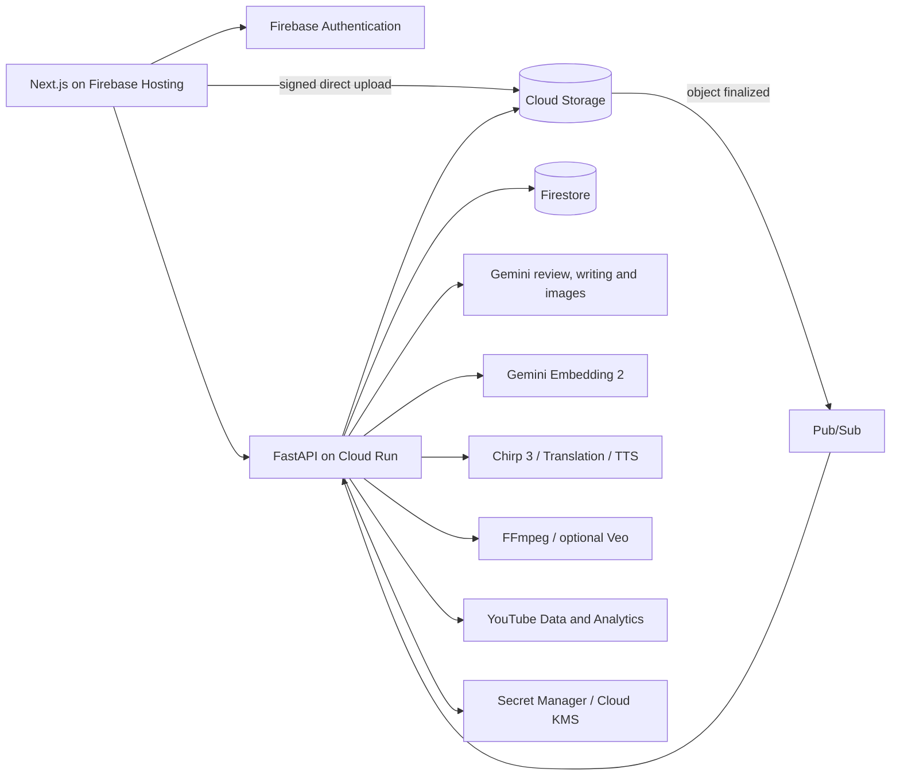

# Resonance Creator Studio

Resonance turns one video upload into an editorial review. Nine specialist Gemini
reviewers place findings on a seekable heatmap under the timeline, above a predicted
audience-interest curve that marks where the content beats or falls short of the typical
drop-off. Each finding links to the moment, an explanation and a concrete edit. The same workspace then uses the
creator's earlier work for drafts, thumbnails, localized captions and dubbing, a YouTube
package, and scheduled publishing.

**[Live app](https://habeas-codus.web.app)** ·
[How it compares](#how-resonance-compares) · [Architecture](docs/architecture.md) ·
[Evidence](evals/README.md) · [Costs](docs/costs.md) · [API contract](contracts/openapi.yaml)

Built for the AI Builder Cup's Media, Content & Digital Experiences theme. The Google
Cloud project and some internal resource names still use the original name, `habeas-codus`.

## The problem

A creator finishing a video has to answer four questions: what is wrong, where, why, and
what to change. The answers are spread across tools. A comment says something is wrong but
not where. An AI model returns a single score that cannot be opened or checked against the
footage. A clipper cuts moments out of context, and a separate tool rewrites the copy.
None of them remember the creator's earlier work, voice or visual style, so every session
starts from zero.

Resonance makes the review an inspectable loop. Each warning is tied to a second of video,
backed by a quote or a frame, and paired with a proposed edit the creator can accept,
revise or reject. The creator's history is an input in its own right and is kept separate
from facts about the current video.

## What it does

| Workflow | Implemented behavior |
|---|---|
| Review a video | Nine specialist Gemini reviewers examine the transcript and sampled footage: truth/evidence, clarity, pacing/retention, legal/safety, cultural/localization, platform fit, audience/brand, emotional impact and conversion/CTA. Reviewers can request frames or clips through a bounded tool loop; the truth reviewer can opt into Google Search grounding. Findings carry timestamps, explanations and concrete edits, and a five-second heatmap seeks straight to the moment. Reviewed stretches with nothing to flag are shown as reviewed, not blank. An audience-interest lane, trained on YouTube Most Replayed data with Gemini moment signals, draws a relative interest curve against the typical drop-off. Its peaks and dips link to the overlapping findings. |
| Work with the transcript | Chirp 3 word timings and speaker labels, optional conservative Gemini cleanup, editable transcript versions, search, SRT/VTT/text export and source-video revisions. |
| Preserve creator context | A searchable library of attributed passages and thumbnails, embedded with Gemini Embedding 2. Retrieved writing informs initial drafts, and retrieved images become thumbnail style references. An explorable map shows the sources and how they relate semantically. |
| Write and revise | Brief-driven drafts and scripts, grounded writing chat, editable blocks, version history, inline alternatives and Markdown/text exports. |
| Prepare media | Five caption styles with live preview and FFmpeg burn-in; translation, terminology and cultural adaptation, and timed dubbing across a 25-language voice catalog. Thumbnails use source frames and creator references, with critique, revisions and downloads. |
| Package the video | Editable or generated YouTube listings and source-linked visual insert suggestions. Charts and callouts render locally with FFmpeg. An optional six-second illustrative shot uses bounded Veo requests grounded in the source's observed look. See the [validation scope](docs/architecture.md#packaging). |
| Publish and plan | YouTube OAuth, content/caption and audience sync, video upload with optional thumbnail and captions, scheduled YouTube publication, and a month/week content calendar. Written drafts can be cross-posted to Substack (session cookie, since Substack has no write API), Medium (legacy integration tokens only) and Reddit (OAuth). |
| Own the workspace | Google sign-in, a researched and editable persona, avatars, project revisions, job progress over WebSocket, and project/account deletion. The shared demo is read-only. |

The heatmap is the core interaction. A creator can read a quote, see why it matters, read
the proposed change, and jump to the matching footage. Scores mark **flagged moments**.
They are not predicted retention or a calibrated whole-video rating. The interest lane
answers a different question: *where* viewers are likely to lean in or drift. The reviewers
answer *why*, and *what to change*. The creator decides.

## How the AI works

The models generate language, critique and media. Plain code decides what reaches the
creator and how each result is anchored to the source.

1. **Upload.** The API checks ownership and issues a short-lived signed URL. The browser
   uploads directly to Cloud Storage, so large files never pass through the request path.
2. **Transcribe.** Upload completion and the Storage `object finalized` Pub/Sub push
   converge on one atomically created transcription job. Chirp 3 returns words and
   speaker labels. Invalid timings are clamped, and optional cleanup keeps the raw result
   if it fails.
3. **Pin the run.** Analysis pins the asset, transcript and persona version, then splits
   the transcript into ~36,000-character windows with two neighbouring segments of context
   on each side. Every segment and timeline interval has exactly one owning chunk.
4. **Review.** Nine reviewers run over those chunks. The six core dimensions always run;
   concurrency defaults to four. Up to three stills for short videos or six for longer
   ones are shared with the relevant chunks. A reviewer may request a frame or clip through
   a bounded tool loop: three requests and two rounds per reviewer and chunk. Only the
   truth reviewer uses Search grounding.
5. **Normalize.** Timestamps are clamped. Speech quotes that do not match the transcript
   are rejected. Explanations and actions are required. Exact overlapping duplicates are
   removed within a dimension. Useful partial results persist even when another dimension
   fails, and the run reports where coverage is incomplete.
6. **Build the heatmap.** Five-second bins aggregate scores weighted by temporal overlap
   and keep finding IDs. A critical observation forces red. Time with no findings gets no
   score. Each run records which spans every reviewer actually read, so a covered gap shows
   as "reviewed, nothing flagged" and a failed chunk shows as unreviewed. Selecting a bin
   filters the findings and seeks the player.
7. **Predict interest.** In parallel with the reviewers, one bounded Gemini pass (at most
   four calls) rates every five-second bin for hook, payoff, novelty, open loop, emotion,
   humour, practical value, on-screen cue and tangent. A ridge model shipped as JSON
   coefficients combines those ratings with transcript pace, pauses and novelty, and with a
   position head for the typical drop-off. Peaks and dips are the bins that most beat or
   fall short of that drop-off, and they link to the overlapping findings. Without the
   Gemini pass the curve still renders, but no moments are marked.
8. **Ground the writing.** Initial drafts retrieve relevant creator passages, drop shallow
   excerpts and reorder a bounded set of examples before the writer sees them. The selected
   context is saved for inspection. Thumbnails retrieve original images as style references.
9. **Prepare media.** Captions render as ASS through FFmpeg. Localization translates the
   segments, then runs a Gemini adaptation pass over a bundled terminology and trap corpus
   plus the project glossary. TTS output is tempo-adjusted to each segment's window and
   mixed with optional quiet original audio. This is timed synthesis, not lip sync or voice
   cloning.
10. **Package and publish.** Gemini selects transcript segment indices for listings and
   insert suggestions. Code derives the quotes, timestamps and chart values from the source.
   YouTube uses OAuth with PKCE, encrypted tokens and optional scheduled publication.

These are specialized prompts over one shared model, not nine independent experts.
Normalization guarantees format and quote consistency. It cannot prove that a factual
verdict is correct. Confidence fields are not calibrated probabilities, and the aggregate
summarizes flagged moments. It is not a video-wide quality or retention metric.

## How creator context is used

A persona records the creator's preferences. Their past work supplies examples. Resonance
keeps these two roles separate and labels each one, so neither is presented as fact.

- **One space for text and images.** Text and thumbnail-plus-title inputs are embedded
  with Gemini Embedding 2 into the same 768-dimensional, unit-normalized space.
- **Retrieval is a separate, inspectable step.** Search ranks full-space cosine similarity
  and returns up to eight passages. The map is a repeatable centered-PCA projection, and
  related links are cosine neighbours from distinct sources. Cosine measures relevance, not
  confidence.
- **Evidence keeps its provenance.** Node IDs hash the source identity, excerpt, content
  fingerprint, model, dimensions and prompt version. A cached vector is therefore tied to
  the exact content that produced it. Every retrieved passage and image is shown with its
  attribution.
- **Bounded and reproducible.** Passages use 1,400-character windows with a 1,200-character
  stride. Long sources contribute at most six evenly sampled passages. An index caps at 300
  nodes and ten images. Query vectors are cached by query, model, dimensions and version.
  A provider error falls back to lexical overlap, and precomputed preset vectors install
  with no model calls.
- **Limits of reach.** Heatmap reviewers and inline writing alternatives do not use
  semantic retrieval. Initial drafts, thumbnail references and packaging context do. The
  retrieval is a bounded Python scan, not a managed vector database, and the persona is not
  learned automatically.

## Google Cloud architecture



Firebase Hosting serves a static Next.js 16 export. Cloud Run hosts the API and the current
background workers. Firestore holds workflow state and evidence references, and Storage
holds media. Every Google call goes through a provider boundary under Application Default
Credentials, so feature code never touches a Google SDK directly.

| Service | Implemented role |
|---|---|
| Firebase Hosting | Static Next.js 16 export, API and project-shell rewrites |
| Firebase Authentication | Google sign-in, ID-token verification, passwordless read-only demo |
| Cloud Run | FastAPI plus the current background workers; one instance, CPU available outside requests |
| Firestore | Users, revisions, jobs, findings, heatmaps, drafts, connectors, library vectors and schedules |
| Cloud Storage | Signed uploads/downloads for source media, transcripts, thumbnails, rendered captions, dubs and evidence |
| Pub/Sub | Storage-finalized transcription trigger; best-effort transcript and analysis announcements with no subscribers |
| Gemini on Vertex AI / Agent Platform | Structured review, writing, research, cleanup, adaptation, packaging and thumbnail critique |
| Gemini Embedding 2 | Text and image embeddings for creator evidence retrieval |
| Gemini image generation | Thumbnail generation and conversational revisions |
| Speech-to-Text V2 | Chirp 3 batch recognition, word timings and optional diarization |
| Translation Advanced / Text-to-Speech | Translation, adaptation and timed speech synthesis |
| FFmpeg / ffprobe | Evidence frames and clips, caption burn-in, timed audio assembly and insert rendering |
| Veo | Optional bounded six-second illustrative inserts |
| YouTube Data / Analytics | OAuth-backed sync, upload, captions, thumbnails and scheduled publication |
| Secret Manager / Cloud KMS | OAuth client secrets and encryption of stored tokens |
| Artifact Registry / GitHub WIF | Container storage and keyless deployment via Workload Identity Federation |
| Cloud Billing / Pub/Sub / Cloud Function | Budget notifications and a billing-detachment backstop |

Regional infrastructure is in `us-central1`. Speech-to-Text uses the `us` multi-region,
where Chirp 3 is GA. Gemini uses the configured `global` endpoint, and Veo is regional.
Terraform defines the infrastructure, and GitHub Actions deploys without long-lived CI
keys. Terraform provisions no BigQuery datasets or separate worker service accounts. Workers run
inside the single Cloud Run service.

## Evidence

Measured on 11 October 2026. Full methods, hashes, machine metadata and per-query results
are in [the evaluation report](evals/README.md). Retrieval and local processing have
quantitative results. Editorial quality and creator impact have no independent labels yet.

| Measurement | Result | Scope |
|---|---|---|
| Interest beyond the typical drop-off | **ρ = 0.17** (95% CI 0.10–0.24); dips in the true bottom quarter **37%**, peaks in the top quarter **35%** (chance 25%) | Grouped CV over 45 unseen creator channels, Most Replayed labels; transcript statistics alone do not beat chance. [Report](evals/interest/README.md) |
| Intended source ranked first | Semantic **20/20**, keyword fallback **11/20** | 20 curated, author-labeled source-relevance queries on one creator corpus (12 English, 4 Hindi, 4 text-to-image). Labels were assigned before inference. |
| Retrieval ranking quality | Semantic **MRR@8 1.000**, keyword **0.598** | Same cohort; hit@3 **20/20 vs 12/20**, hit@8 **20/20 vs 15/20**. |
| Local media probing | **49.9–50.4% lower median time** | Combined metadata probe versus two separate probes, three real videos, seven interleaved repetitions each. |
| Query embedding latency | **443.7 ms median, 702.5 ms p95** | Twenty real sequential provider calls, including the first client's cold setup. |
| Cosine scoring / PCA projection | **1.36 ms / 3.53 ms median** | 100 and 7 warmed local runs over the real 80-vector corpus; excludes network and UI. |
| Initial project-page JavaScript | **54.0% smaller gzip estimate** | Recorded before/after webpack build; initial route scripts only, not total transfer. |

Each cohort filters by modality. Thumbnail retrieval targets images, and text search
normally mixes modalities. Filtering isolates retrieval instead of testing the whole public
API. The harness imports the production passage builder, vector validator and cosine
helper. An offline replay reproduced every retrieval metric with **zero new model calls**.

### Cost, computed not billed

These are arithmetic scenarios built from list prices checked on 11 October 2026, not
invoices. A five-minute example with nine reviewers using 45,000 input and 9,000
output/reasoning tokens costs **$0.0675 for review** at the configured introductory Flash
rates. Standard STT adds **$0.08**, and four 1K thumbnail outputs add about **$0.268**.

| Chosen stages | Model/API component subtotal |
|---|---:|
| Transcription + review | **$0.1475** |
| Above + four thumbnail outputs | **$0.4155** |
| All listed scenario stages | **$0.65925** |

These are **partial component subtotals**. Search, image inputs, planning and critique,
persona research, embeddings, compute, storage, egress and retries are excluded. The guards
that bound spend are documented in [costs](docs/costs.md#what-the-guards-actually-enforce):
a $5 stored-analysis ceiling, a separate $5 image budget, 200 embedding slots per user per
day, at most two reserved Veo slots per project, and a Cloud Billing backstop. Reproduce
the table with `uv run --project backend python backend/scripts/estimate_cost.py`.

## How Resonance compares

Public product documentation and USD pricing were checked on **11 October 2026**. This
compares capabilities against the implemented Resonance code. It is not a hands-on
benchmark. No competitor outputs or creator task times were collected, and feature
availability varies by plan and region. The full write-up is in
[the comparison document](docs/competitive-comparison.md).

| Tool | What it is | Resonance's implemented distinction | Where the other tool is stronger |
|---|---|---|---|
| **Descript** | Underlord reads scripts, watches video, gives feedback and executes edits; transcript editing, cleanup, clips and media generation. [Product](https://www.descript.com/underlord) | Nine named review dimensions and a five-second seekable heatmap that organize critique, evidence and proposed edits. Grounding and footage tools are bounded. | Real source-video editing: multicam, layouts, audio repair and finished clips. Resonance suggestions still need an external edit to become a rendered short. |
| **OpusClip** | ClipAnything uses visual, audio and sentiment cues to select moments, assemble clips and reframe them. Paid tiers add captions and publishing. [Product](https://www.opus.pro/clipanything) | Reviews factual support, clarity, safety and cultural fit, not only pacing. The creator inspects and revises each piece of advice before packaging. | Automated finished shorts, subject tracking and reframing, and wider social distribution. Resonance does not cut source shorts automatically. |
| **YouTube Studio** | Retention from real viewers, native title/thumbnail experiments, and Ask Studio advice on scripts and unpublished videos. [Ask Studio](https://support.google.com/youtube/answer/16291691?hl=en) | One multi-dimension review interface, editable transcript versions, a localization glossary and downloadable media in a single project. | First-party audience evidence, concurrent experiments and native channel operations. Resonance scores describe flagged moments, not predicted retention. |
| **ChatGPT** | Flexible critique, research and drafting. Projects keep files, instructions and shared context. [Projects](https://learn.chatgpt.com/docs/projects) | A predefined video-review pipeline with a persistent player, timed findings, evidence references, revisions and media exports. It removes setup the creator would otherwise do by hand. | General-purpose reasoning and flexible workflows. A well-prompted, context-rich project is a credible baseline, and persistent context is not unique to Resonance. |
| **Gemini Apps** | Uploads and analyzes video. Reusable instructions and reference files through Gems. [Gems](https://support.google.com/gemini/answer/15146780?hl=en) | Turns video analysis into structured review jobs, partial results, timed navigation and saved publishing assets. | Direct conversational video analysis with almost no setup. Gemini is also Resonance's model provider, so model quality is not an advantage Resonance holds alone. |

Closer editorial-review tools such as [HookMaster](https://tryhookmaster.com/) and
[Retensis](https://retensis.com/) advertise timestamped feedback and creator memory. So
Resonance is not the only timestamped AI review tool, and it is not the only one with
creator memory. Its combination is review breadth, inspectable evidence, creator references
reused across writing and visual generation, and a Google Cloud implementation with typed
contracts, ownership checks and deletion.

### Price context

Representative individual plans, before taxes and promotions. Annual equivalents require
annual billing. Several tools have free plans, and these are not a recommended stack to
buy together.

| Product | Monthly billing | Included allowance/context |
|---|---:|---|
| Descript Hobbyist | $24/month | 10 media hours and 400 AI credits/month |
| OpusClip Starter | $15/month | 150 credits/month |
| ChatGPT Plus | $20/month | Subscription limits, separate from API billing |
| Google AI Pro | $19.99/month | Gemini plus bundled benefits; regional prices vary |
| **Resonance scenario** | No retail plan established | STT + assumed review tokens: **$0.1475 partial subtotal** |

Ten five-minute reviews on the same assumed tokens come to **$1.475** of STT and review
components, and a hundred come to **$14.75**. These figures exclude Search, footage inputs,
cleanup, retries, compute, storage and support. Credit counts are not counts of complete
reviews. The numbers cannot show savings against a subscription or a sustainable price. The
right denominator is total cost per completed review and per creator-accepted edit.

### What the evidence supports

The repository shows structured, source-linked editorial review, reusable creator
references, and a wider implemented feature set than any single tool in the table. The
retrieval result compares Resonance's semantic search with its own keyword fallback on a
curated corpus. It says nothing about competitors.

Accuracy, time saved and cost against Descript are untested. They are hypotheses for the
[creator comparison protocol](evals/creator-comparison.md). Until that study runs, the
supported description is that Resonance is built to make editorial review inspectable and to
carry the creator's own evidence into each downstream asset.

## Known limitations

- **Reviewers are prompts over one model.** Format and quote consistency are enforced.
  Factual correctness and severity are not. Confidence fields are not calibrated.
- **Interest is a proxy, and a weak one.** The curve learns from public Most Replayed graphs
  (rewatching, not retention) on 45 creator videos plus short brand clips. It sees the
  transcript, not the frames. It ranks moments within one video and points at places to
  look. It does not score the video.
- **Editorial quality is unmeasured.** No blind creator labels or gold-issue set exist yet.
  Finding counts and successful JSON responses are not quality scores.
- **Retrieval is a bounded scan.** Indexes cap at 300 text nodes and ten images. A provider
  error falls back to lexical overlap. Heatmap reviewers and inline alternatives do not use
  semantic retrieval at all.
- **Single-instance runtime.** Job execution locks and the realtime hub are process-local,
  and the current deployment caps Cloud Run at one instance. Durable worker leases and
  shared event delivery are needed before scaling out.
- **Provider reliability and cost.** A [429 diagnosis](docs/current-progress/HANDOFF.md#open-items)
  found STT resubmissions after polling errors and short image backoff. Job idempotency does
  not prevent duplicates inside a provider retry loop. That repair is separate from this
  documentation.
- **Deletion removes live data.** Versioned buckets keep noncurrent generations until
  lifecycle expiry. Shared immutable preset archives survive user deletion by design.
- **Media scope.** Dubbing is timed synthesis, not lip sync or voice cloning. Visual inserts
  supplement a video and are not spliced into it. Automatic source shorts, video-project chat
  are not implemented. Video publishing is YouTube only. Written cross-posting covers
  Substack, Medium and Reddit. Medium no longer issues new tokens, and Substack relies on an
  unofficial session cookie. Cross-posts run immediately and are not scheduled.

## Run locally

Prerequisites: Bun, uv with Python 3.12+, the Google Cloud CLI, FFmpeg/ffprobe, and access
to the configured Google Cloud project. Local development calls live APIs, which can incur
charges.

```bash
gcloud auth application-default login
gcloud auth application-default set-quota-project habeas-codus

cd backend
uv sync
cp .env.example .env
uv run uvicorn app.main:app --reload --port 8080
```

In another terminal:

```bash
cd web
bun install
cp .env.example .env.local
bun dev
```

Open `http://localhost:3000`. Fill the web environment with the public Firebase config in
[infra/RESOURCES.md](infra/RESOURCES.md). Model settings live in `backend/.env.example` and
`.env.deploy.example`. Availability and prices depend on the endpoint you choose. YouTube
OAuth is optional for editing and reviewing content.

```bash
# backend/
uv run ruff check .
uv run mypy app

# web/
bun run lint
bun run lint:eslint
bun run build
```

## Repository

| Path | Purpose | Tooling |
|---|---|---|
| `web/` | Next.js 16, React 19, TypeScript, TanStack Query, Tailwind and Base UI | Bun |
| `backend/` | FastAPI, providers, services, reviewers, media workers and operator scripts | uv |
| `infra/` | Terraform, IAM, storage, events, encryption and the budget backstop | Terraform |
| `contracts/` | OpenAPI, Firestore, event and creator-import contracts | — |
| `evals/` | Retrieval cases, benchmark results and evaluation methodology | — |
| `fixtures/`, `corpus/` | Source configurations, local media/import examples and localization guidance | — |
| `docs/` | Architecture, cost model, comparison, technical references and the handoff | — |

The current code is described in [docs/architecture.md](docs/architecture.md). Decisions,
deployment state and open items are in [docs/current-progress/HANDOFF.md](docs/current-progress/HANDOFF.md). Automatic shorts, video-project chat and video publishing beyond YouTube are not built.
Draft writing chat is. The live deployment may lag the working tree, and historical demo
analyses keep the prompts and dimensions they were created with.
