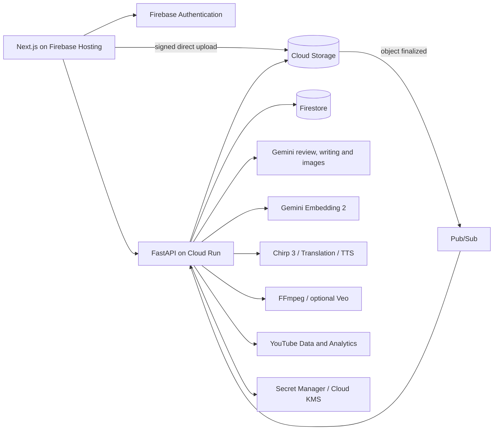

# Resonance Creator Studio

One video upload becomes an inspectable editorial review. Nine specialist Gemini
reviewers place findings on a seekable heatmap under the timeline; every finding links
the moment, the explanation and a concrete edit to the footage. The same workspace then
carries the creator's own past work forward into drafts, thumbnails, localized captions
and dubbing, a YouTube package, and a scheduled publication.

**[Live app](https://habeas-codus.web.app)** ·
[How it compares](#how-resonance-compares) · [Architecture](docs/architecture.md) ·
[Evidence](evals/README.md) · [Costs](docs/costs.md) · [API contract](contracts/openapi.yaml)

Built for the AI Builder Cup's **Media, Content & Digital Experiences** theme. The Google
Cloud project and some internal resource names keep the original name, `habeas-codus`.

## The problem

When a creator finishes a video, four questions decide whether it works: what is wrong,
where exactly, why, and what should I change? Today those answers are scattered. A
comment tells you *something* but not *where*. An AI model gives a single score you
cannot open, inspect or trust against the footage. A clipper cuts moments out of context,
and a separate tool rewrites the copy. None of them remember the creator's own body of
work, its voice or its visual style, so every session starts from zero.

The knowledge that would make the advice good — the creator's prior videos, their terms,
their tone — sits in a different tab and never reaches the critic. Resonance makes the
review an **inspectable loop** instead of a number: each warning is anchored to a second
of video, backed by a quote or a frame, and paired with a proposed edit the creator can
accept, revise or reject. The creator's history is a first-class input, kept distinct
from the current video's facts.

## What it does

| Workflow | Implemented behavior |
|---|---|
| Review a video | Nine specialist Gemini reviewers examine the transcript and sampled footage: truth/evidence, clarity, pacing/retention, legal/safety, cultural/localization, platform fit, audience/brand, emotional impact and conversion/CTA. Reviewers can request frames or clips through a bounded tool loop; the truth reviewer can opt into Google Search grounding. Findings carry timestamps, explanations and concrete edits, and a five-second heatmap seeks straight to the moment. |
| Work with the transcript | Chirp 3 word timings and speaker labels, conservative optional Gemini cleanup, editable transcript versions, search, SRT/VTT/text export and source-video revisions. |
| Preserve creator context | A searchable library of attributed passages and thumbnails, embedded with Gemini Embedding 2. Retrieved writing informs initial drafts; retrieved images become thumbnail style references. An explorable map exposes the sources and their actual semantic relationships. |
| Write and revise | Brief-driven drafts and scripts, grounded writing chat, editable blocks, version history, inline alternatives and Markdown/text exports. |
| Prepare media | Five caption styles with live preview and FFmpeg burn-in; translation, terminology/cultural adaptation and timed dubbing across a 25-language voice catalog. Thumbnails use source frames and creator references, with critique, revisions and downloads. |
| Package the video | Editable or generated YouTube listings and source-linked visual insert suggestions. Charts and callouts render locally with FFmpeg; an optional six-second illustrative shot uses bounded Veo requests grounded in the source's observed look. See the [validation scope](docs/architecture.md#packaging). |
| Publish and plan | YouTube OAuth, content/caption and audience sync, real video upload with optional thumbnail and captions, scheduled YouTube publication, and a month/week content calendar. |
| Own the workspace | Google sign-in, a researched and editable persona, avatars, project revisions, job progress over WebSocket, and real project/account deletion. The shared demo is read-only. |

The heatmap is the core interaction. A creator can inspect a quote, see why it matters,
read a proposed change, and jump to the corresponding footage. Scores describe **flagged
moments**, not predicted retention or an independently calibrated whole-video rating.

## How the AI works

The models generate language, critique and media; plain code decides what is allowed to
reach the creator and how each result is anchored to the source.

1. **Upload.** The API checks ownership and issues a short-lived signed URL; the browser
   uploads directly to Cloud Storage so large files never pass through the request path.
2. **Transcribe.** Upload completion and the Storage `object finalized` Pub/Sub push
   converge on one atomically created transcription job. Chirp 3 returns words and
   speaker labels; invalid timings are clamped, and optional cleanup preserves the raw
   result on failure.
3. **Pin the run.** Analysis pins the asset, transcript and persona version, then
   partitions the transcript into ~36,000-character windows with two neighbouring segments
   of context on each side. Every segment and timeline interval has one owning chunk.
4. **Review.** Nine reviewers run over those chunks (six core dimensions are always
   included; concurrency defaults to four). Up to three stills for short videos or six for
   longer ones are shared with the relevant chunks. A reviewer may request a frame or clip
   through a bounded tool loop — three requests and two rounds per reviewer/chunk — and
   only truth review opts into Search grounding.
5. **Normalize.** Timestamps are clamped, non-matching speech quotes are rejected,
   explanations and actions are required, and exact overlapping duplicate advice is
   removed within a dimension. Useful partial results persist even if another dimension
   fails, and the run reports where coverage is incomplete.
6. **Build the heatmap.** Five-second bins aggregate scores weighted by temporal overlap
   and keep finding IDs. A critical observation forces red; untouched time is never given
   an invented score. Selecting a bin filters the findings and seeks the player.
7. **Ground the writing.** Initial drafts retrieve relevant creator passages, drop shallow
   excerpts and reorder bounded examples before the writer sees them. The selected context
   is persisted for inspection. Thumbnails retrieve original images as style references.
8. **Prepare media.** Captions render as ASS/FFmpeg. Localization translates segments then
   applies a Gemini adaptation pass over a bundled terminology/trap corpus and the project
   glossary; TTS output is tempo-adjusted to segment windows and muxed with optional quiet
   original audio. This is timed synthesis, not lip sync or voice cloning.
9. **Package and publish.** Gemini selects transcript segment indices for listings and
   insert suggestions; code derives the quotes, timestamps and chart values from the source.
   YouTube uses OAuth with PKCE, encrypted tokens and optional scheduled publication.

These are **specialized prompts over a shared model, not nine independent human experts.**
Normalization guarantees format and quote consistency; it cannot prove a factual verdict
is correct. Confidence fields are not calibrated probabilities, and the aggregate is a
summary of flagged moments rather than a video-wide quality or retention metric.

## The embedding philosophy

A persona captures *preferences*. A creator's past work supplies *examples*. Resonance
keeps those roles distinct and never lets either one masquerade as fact.

- **One space for text and images.** Text and thumbnail-plus-title inputs are embedded
  with Gemini Embedding 2 into the same 768-dimensional, unit-normalized space.
- **Retrieval is a separate, inspectable step.** Search ranks full-space cosine similarity
  and returns up to eight passages; the map is a repeatable centered-PCA projection, and
  related links are cosine neighbours from distinct sources. Cosine means relevance, not
  confidence.
- **Evidence keeps its provenance.** Node IDs hash source identity, excerpt, content
  fingerprint, model, dimensions and prompt version, so a cached vector is always tied to
  the exact content that produced it. Every retrieved passage and image is shown to the
  creator with its attribution.
- **Bounded and reproducible.** Passages use 1,400-character windows at a 1,200-character
  stride; long sources contribute at most six evenly sampled passages and an index caps at
  300 nodes and ten images. Query vectors are cached by query/model/dimensions/version, a
  provider error falls back to lexical overlap, and precomputed preset vectors install with
  no model calls.
- **Honest about its reach.** Heatmap reviewers and inline writing alternatives do **not**
  currently use semantic retrieval. Initial drafts, thumbnail references and packaging
  context do. It is a bounded Python scan, not a managed vector database and not an
  automatically learned persona.

## Google Cloud architecture



Firebase Hosting serves a static Next.js 16 export; Cloud Run hosts the API and current
workers. Firestore holds workflow state and evidence references; Storage holds media.
Every Google call crosses a provider boundary under Application Default Credentials, so
no feature code touches a Google SDK directly.

| Service | Implemented role |
|---|---|
| Firebase Hosting | Static Next.js 16 export, API and project-shell rewrites |
| Firebase Authentication | Google sign-in, ID-token verification, passwordless read-only demo |
| Cloud Run | FastAPI plus the current background workers; one instance, CPU available outside requests |
| Firestore | Users, revisions, jobs, findings, heatmaps, drafts, connectors, library vectors and schedules |
| Cloud Storage | Signed uploads/downloads for source media, transcripts, thumbnails, rendered captions, dubs and evidence |
| Pub/Sub | Storage-finalized transcription trigger and pipeline announcements |
| Gemini on Vertex AI / Agent Platform | Structured review, writing, research, cleanup, adaptation, packaging and thumbnail critique |
| Gemini Embedding 2 | Text and image embeddings for creator evidence retrieval |
| Gemini image generation | Thumbnail generation and conversational revisions |
| Speech-to-Text V2 | Chirp 3 batch recognition, word timings and optional diarization |
| Translation Advanced / Text-to-Speech | Translation, adaptation and timed speech synthesis |
| FFmpeg / ffprobe | Evidence frames and clips, caption burn-in, timed audio assembly and insert rendering |
| Veo | Optional bounded six-second illustrative inserts |
| YouTube Data / Analytics | OAuth-backed sync, upload, captions, thumbnails and scheduled publication |
| Secret Manager / Cloud KMS | OAuth client secrets and encryption of stored tokens |
| Artifact Registry / GitHub WIF | Container storage and keyless deployment via Workload Identity Federation |
| Cloud Billing / Pub/Sub / Cloud Function | Budget notifications and a billing-detachment backstop |

Regional infrastructure is in `us-central1`, Speech-to-Text uses the `us` multi-region
(where Chirp 3 is GA), Gemini uses the configured `global` endpoint, and Veo is regional.
Terraform defines infrastructure and GitHub Actions deploys without long-lived CI keys.
BigQuery datasets and extra event subscriptions are provisioned expansion paths, not live
dashboards or separately deployed workers.

## Evidence

Measured on 11 October 2026; full methods, hashes, machine metadata and individual results
are in [the evaluation report](evals/README.md). Retrieval and local processing have
quantitative results; editorial quality and creator impact do not yet have independent
labels.

| Measurement | Result | Scope |
|---|---|---|
| Intended source ranked first | Semantic **20/20**, keyword fallback **11/20** | 20 curated, author-labeled source-relevance queries on one creator corpus (12 English, 4 Hindi, 4 text-to-image); labels assigned before inference. |
| Retrieval ranking quality | Semantic **MRR@8 1.000**, keyword **0.598** | Same cohort; hit@3 **20/20 vs 12/20**, hit@8 **20/20 vs 15/20**. |
| Local media probing | **49.9–50.4% lower median time** | Combined metadata probe versus two separate probes, three real videos, seven interleaved repetitions each. |
| Query embedding latency | **443.7 ms median, 702.5 ms p95** | Twenty real sequential provider calls, including the first client's cold setup. |
| Cosine scoring / PCA projection | **1.36 ms / 3.53 ms median** | 100 and 7 warmed local runs over the real 80-vector corpus; excludes network and UI. |
| Initial project-page JavaScript | **54.0% smaller gzip estimate** | Recorded before/after webpack build; initial route scripts only, not total transfer. |

Each cohort filters by modality because thumbnail retrieval targets images while text
search normally mixes modalities, so this isolates retrieval rather than exercising the
whole public API. The harness imports the production passage builder, vector validator and
cosine helper, and an offline replay reproduced every retrieval metric with **zero new
model calls**.

### Cost, computed not billed

Examples use published list prices checked 11 October 2026 and are arithmetic scenarios,
not invoices. A five-minute example with nine reviewers consuming 45,000 input and 9,000
output/reasoning tokens costs **$0.0675 for review** at the configured introductory Flash
rates. Standard STT adds **$0.08**; four 1K thumbnail outputs add about **$0.268**.

| Chosen stages | Model/API component subtotal |
|---|---:|
| Transcription + review | **$0.1475** |
| Above + four thumbnail outputs | **$0.4155** |
| All listed scenario stages | **$0.65925** |

These are **partial component subtotals**: Search, image inputs, planning/critique,
persona research, embeddings, compute, storage, egress and retries are excluded. The flags
that actually bound spend are documented in [costs](docs/costs.md#what-the-guards-actually-enforce):
a $5 stored-analysis ceiling, a separate $5 image budget, 200 embedding slots per user per
day, at most two reserved Veo slots per project, and a Cloud Billing backstop. Reproduce
the table with `uv run --project backend python backend/scripts/estimate_cost.py`.

## How Resonance compares

Public product documentation and USD pricing checked **11 October 2026**. This is a
capability comparison against the inspected Resonance implementation — not a hands-on
benchmark. No competitor outputs or creator task times were collected, and feature
availability varies by plan and region. The full write-up is in
[the comparison document](docs/competitive-comparison.md).

| Tool | What it is | Resonance's implemented distinction | Where the other tool is stronger |
|---|---|---|---|
| **Descript** | Underlord reads scripts, watches video, gives feedback and executes edits; transcript editing, cleanup, clips and media generation. [Product](https://www.descript.com/underlord) | Nine named review dimensions and a five-second seekable heatmap that organize critique, evidence and proposed edits; grounding and footage tools are explicitly bounded. | Real source-video editing: multicam, layouts, audio repair and finished clips. Resonance suggestions still need an external edit to become a rendered short. |
| **OpusClip** | ClipAnything uses visual, audio and sentiment cues to select moments, assemble clips and reframe them; paid tiers add captions and publishing. [Product](https://www.opus.pro/clipanything) | Reviews factual support, clarity, safety and cultural fit — not just pacing — and lets the creator inspect and revise each piece of advice before packaging. | Automated finished shorts, subject tracking/reframing and wider social distribution. Resonance does not cut source shorts automatically. |
| **YouTube Studio** | Retention from real viewers, native title/thumbnail experiments and Ask Studio advice on scripts and unpublished videos. [Ask Studio](https://support.google.com/youtube/answer/16291691?hl=en) | One explicit multi-dimension review interface, editable transcript versions, a localization glossary and downloadable media in a single project. | First-party audience evidence, concurrent experiments and native channel operations. Resonance scores describe flagged moments, not predicted retention. |
| **ChatGPT** | Flexible critique, research and drafting; Projects retain files, instructions and shared context. [Projects](https://learn.chatgpt.com/docs/projects) | A predefined video-review pipeline with a persistent player, timed findings, evidence references, revisions and media exports removes the setup a creator would otherwise assemble by hand. | General-purpose reasoning and flexible workflows; a well-prompted, context-rich project is a credible baseline, and persistent context is not unique to Resonance. |
| **Gemini Apps** | Uploads and analyzes video; reusable instructions and reference files via Gems. [Gems](https://support.google.com/gemini/answer/15146780?hl=en) | Converts video intelligence into structured review jobs, partial results, timed navigation and saved publishing assets. | Direct conversational video analysis with almost no setup. Gemini is also Resonance's model provider, so model intelligence itself is not an exclusive advantage. |

Closer editorial-review entrants such as [HookMaster](https://tryhookmaster.com/) and
[Retensis](https://retensis.com/) advertise timestamped feedback and creator memory.
Resonance does not claim to be the only timestamped AI review tool or the only one with
creator memory. The defensible demonstration is the **combination**: review breadth,
inspectable evidence, creator references reused across writing and visual generation, and
a real Google Cloud implementation with typed contracts, ownership checks and deletion.

### Price context

Representative individual plans, before taxes and promotions; annual equivalents require
annual billing. Free plans exist for several tools — these are not a recommended stack to
buy together.

| Product | Monthly billing | Included allowance/context |
|---|---:|---|
| Descript Hobbyist | $24/month | 10 media hours and 400 AI credits/month |
| OpusClip Starter | $15/month | 150 credits/month |
| ChatGPT Plus | $20/month | Subscription limits, separate from API billing |
| Google AI Pro | $19.99/month | Gemini plus bundled benefits; regional prices vary |
| **Resonance scenario** | No retail plan established | STT + assumed review tokens: **$0.1475 partial subtotal** |

Ten five-minute reviews on the same assumed tokens sum to **$1.475** of STT/review
components and a hundred to **$14.75**, excluding Search, footage inputs, cleanup, retries,
compute, storage and support. Credit counts are not counts of complete reviews. **These
figures cannot establish savings against a subscription or a sustainable price; the right
denominator is total cost per completed review and per creator-accepted edit.**

### What we claim, and what we do not

What the repository demonstrates today: structured, source-linked editorial review
([20/20 semantic vs 11/20 lexical](evals/README.md) retrieval on its own curated corpus),
reusable creator references, and a broader implemented surface than any single competitor
above. What it does **not** establish: that its advice is more accurate, that it saves a
creator hours, or that it is cheaper than Descript — those are hypotheses with a defined
[creator-comparison protocol](evals/creator-comparison.md). Until that study runs, the
honest claim is that Resonance is *designed to make editorial review inspectable and to
carry the creator's own evidence into every downstream asset.* The retrieval result
compares Resonance's own semantic search against its own lexical fallback; it says nothing
about competitors.

## Known limitations

- **Reviewers are prompts, not experts.** Nine dimensions are specialized prompts over one
  shared model. Format and quote consistency are enforced; factual correctness and severity
  are not. Confidence fields are not calibrated probabilities.
- **Editorial quality is unmeasured.** No blind, independent creator labels or gold-issue
  set have been collected yet. Finding counts and successful JSON are not quality scores.
- **Retrieval is a bounded scan, not a vector database.** Indexes cap at 300 text nodes and
  ten images; a provider error falls back to lexical overlap. Heatmap reviewers and inline
  alternatives do not use semantic retrieval at all.
- **Single-instance runtime.** Job execution locks and the realtime hub are process-local,
  and the current deployment caps Cloud Run at one instance. Durable worker leases and
  shared event delivery come before scale-out.
- **Provider reliability and cost.** A [429 diagnosis](docs/current-progress/2026-10-11-1639-provider-429-diagnosis.md)
  found STT resubmissions after polling errors and short image backoff. Job idempotency
  does not prevent duplicates inside a provider retry loop; the repair is separate from
  this documentation.
- **Deletion is real, but versioned buckets keep noncurrent generations** until lifecycle
  expiry, and shared immutable preset archives survive user deletion by design.
- **Media scope.** Dubbing is timed synthesis, not lip sync or voice cloning; visual
  inserts supplement a video and are not spliced into it, and automatic source shorts,
  video-project chat and connectors beyond YouTube are not implemented.

## Run locally

Prerequisites: Bun, uv/Python 3.12+, the Google Cloud CLI, FFmpeg/ffprobe, and access to
the configured Google Cloud project. Local development uses live APIs and can incur
charges.

```bash
gcloud auth application-default login
gcloud auth application-default set-quota-project habeas-codus

cd backend
uv sync
cp .env.example .env
uv run uvicorn app.main:app --reload --port 8080
```

In another terminal:

```bash
cd web
bun install
cp .env.example .env.local
bun dev
```

Open `http://localhost:3000`. Fill the web environment with the public Firebase config in
[infra/RESOURCES.md](infra/RESOURCES.md). Model settings live in `backend/.env.example` and
`.env.deploy.example`; availability and prices depend on the chosen endpoint. YouTube OAuth
setup is optional for editing and reviewing content.

```bash
# backend/
uv run ruff check .
uv run mypy app

# web/
bun run lint
bun run lint:eslint
bun run build
```

## Repository

| Path | Purpose | Tooling |
|---|---|---|
| `web/` | Next.js 16, React 19, TypeScript, TanStack Query, Tailwind and Base UI | Bun |
| `backend/` | FastAPI, providers, services, reviewers, media workers and operator scripts | uv |
| `infra/` | Terraform, IAM, storage, events, encryption and the budget backstop | Terraform |
| `contracts/` | OpenAPI, Firestore, event and creator-import contracts | — |
| `evals/` | Retrieval cases, benchmark results and evaluation methodology | — |
| `fixtures/`, `corpus/` | Source configurations, local media/import examples and localization guidance | — |
| `docs/` | Architecture, cost model, comparison, technical references and timestamped handoffs | — |

The current code is described in [docs/architecture.md](docs/architecture.md); historical
decisions and deployment state live in the newest
[docs/current-progress/](docs/current-progress/) note. Automatic shorts, video-project chat
and publishing beyond YouTube remain future work. Draft writing chat is implemented. The
live deployment may lag the working tree, and historical demo analyses retain the prompts
and dimensions used when they were created.
