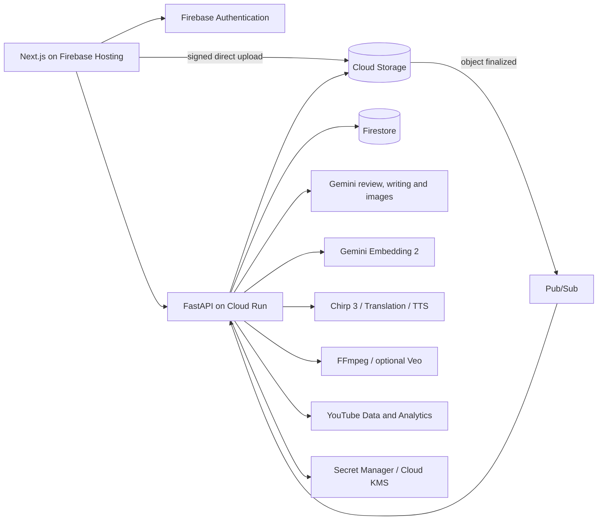

# Resonance Creator Studio

An editorial workspace for creators: understand a video, improve specific moments,
and prepare it for publication while keeping the creator's voice.

**[Live app](https://habeas-codus.web.app)** ·
[Architecture](docs/architecture.md) · [Benchmarks](evals/README.md) ·
[Cost model](docs/costs.md) · [Judging evidence](docs/architecture.md#judging-evidence) ·
[Tool comparison](docs/competitive-comparison.md) ·
[API contract](contracts/openapi.yaml)

Built for the AI Builder Cup's **Media, Content & Digital Experiences** theme.
The Google Cloud project and some internal resource names retain the original name,
`habeas-codus`.

## What it does

| Workflow | Implemented behavior |
|---|---|
| Review a video | Nine specialist Gemini reviewers examine transcript and sampled footage. Reviewers can request frames or clips; factual review can use Google Search. Findings contain timestamps, explanations and concrete edits. A five-second heatmap lets the creator seek directly to the moment. |
| Work with the transcript | Chirp 3 word timings and speaker labels, conservative optional Gemini cleanup, editable transcript versions, search, SRT/VTT/text export and source-video revisions. |
| Preserve creator context | A searchable library of attributed passages and thumbnails, using Gemini Embedding 2. Retrieved writing informs initial drafts; retrieved images become thumbnail style references. The map exposes sources and their actual semantic relationships. |
| Write and revise | Brief-driven drafts and scripts, grounded writing chat, editable blocks, version history, inline alternatives and Markdown/text exports. |
| Prepare media | Five caption styles with live preview and FFmpeg burn-in; translation, terminology/cultural adaptation and timed dubbing, with a 25-language voice catalog. Thumbnails use source frames and creator references, with critique, revisions and downloads. |
| Package the video | Editable/generated YouTube listings and source-linked visual insert suggestions. Charts/callouts render with FFmpeg; optional six-second illustrative footage uses bounded Veo requests. See the [implementation notes](docs/architecture.md#packaging) for validation scope. |
| Publish and plan | YouTube OAuth, content/caption and audience sync, real video upload with optional thumbnail/captions, scheduled YouTube publication, and a month/week content calendar. |
| Own the workspace | Google sign-in, researched/editable persona, avatars, project revisions, job progress over WebSocket, and project/account deletion. The shared demo is read-only. |

The heatmap is the core interaction. A creator can inspect a quote, see why it matters,
read a proposed change, and jump to the corresponding footage. Scores describe **flagged
moments**, not predicted retention or an independently calibrated whole-video rating.

## Google Cloud architecture



Firebase Hosting serves a static Next.js 16 application; Cloud Run hosts the API and
current workers. Firestore holds workflow state and evidence references; Storage holds
media. Google calls cross provider boundaries, with Application Default Credentials.
Review orchestration is bounded Python async fan-out and Gemini function calling.

Regional infrastructure is in `us-central1`, Speech-to-Text uses `us`, and Gemini uses
the configured `global` endpoint. Veo uses `us-central1`. Terraform defines infrastructure;
GitHub Actions deploys through Workload Identity Federation. BigQuery resources are
provisioned for future analytics; current channel analytics are stored in Firestore.

## Why embeddings matter here

A persona captures preferences. A creator's past work supplies examples. Resonance keeps
those roles distinct: it retrieves the relevant passage or original thumbnail, carries
the source attribution forward, and gives that evidence to the generation step.

Text and images share a normalized 768-dimensional space. Search and related-source
links use cosine similarity in that space; the explorable map is an approximate PCA
projection. Content hashes and model/prompt versions keep cached vectors tied to their
sources. The hackathon corpus contains **20 authentic sources and 80 indexed nodes**;
it is visibly an example creator library, not a new user's personal history.

## Evidence and cost

Measurements on 11 October 2026; full methods, hashes and individual results are in
[the evaluation report](evals/README.md).

| Measurement | Result | Scope |
|---|---|---|
| Intended source ranked first | Semantic **20/20**, keyword fallback **11/20** | Curated source-relevance queries on one creator corpus; includes Hindi and thumbnail retrieval. Labels assigned before inference. |
| Local media probing | **49.9–50.4% lower median time** | Combined metadata probe versus two separate probes, three real videos, seven interleaved repetitions each. |
| Initial project-page JavaScript | **54.0% smaller gzip estimate** after prior optimization | Recorded before/after webpack build; initial route scripts only, not total browser transfer. |

A five-minute example with 45,000 review input tokens and 9,000 output/reasoning tokens
costs **$0.0675 for review** at the configured introductory Flash rates. Standard STT
adds **$0.08**; four 1K thumbnail outputs add about **$0.268**. These are component
estimates, excluding Search, image inputs, cleanup, hosting and storage. Translation,
dubbing and optional Veo have separate costs. See [the complete breakdown](docs/costs.md).

Creator time savings, reviewer precision, localization quality, CTR and retention gains
have not been measured. We provide a concrete evaluation protocol for those outcomes.
The prototype currently runs on one Cloud Run instance; distributed worker leases and
shared realtime delivery are required before scaling out.

## Run locally

Prerequisites: Bun, uv/Python 3.12+, Google Cloud CLI, FFmpeg/ffprobe, and access to
the configured Google Cloud project. Local development uses live APIs and can incur charges.

```bash
gcloud auth application-default login
gcloud auth application-default set-quota-project habeas-codus

cd backend
uv sync
cp .env.example .env
uv run uvicorn app.main:app --reload --port 8080
```

In another terminal:

```bash
cd web
bun install
cp .env.example .env.local
bun dev
```

Open `http://localhost:3000`. Fill the web environment with the public Firebase config
in [infra/RESOURCES.md](infra/RESOURCES.md). Model settings live in
`backend/.env.example` and `.env.deploy.example`; availability and prices depend on the
chosen endpoint. YouTube OAuth setup is optional for editing/reviewing content.

```bash
# backend/
uv run ruff check .
uv run mypy app

# web/
bun run lint
bun run lint:eslint
bun run build
```

## Repository

| Path | Purpose |
|---|---|
| `web/` | Next.js, React, TypeScript, TanStack Query, Tailwind and Base UI; Bun |
| `backend/` | FastAPI, providers, services, reviewers, media workers and operator scripts; uv |
| `infra/` | Terraform, IAM, storage, events, encryption and budget backstop |
| `contracts/` | OpenAPI, Firestore, event and creator-import contracts |
| `evals/` | Retrieval cases, benchmark results and evaluation methodology |
| `fixtures/`, `corpus/` | Source configurations, local media/import examples and localization guidance |
| `docs/` | Architecture, cost model, implementation references and timestamped handoffs |

Automatic shorts, video-project chat and publishing beyond YouTube remain future work.
Draft writing chat is implemented. The live deployment may lag the working tree; historical
demo analyses retain the prompts and dimensions used when they were created.
