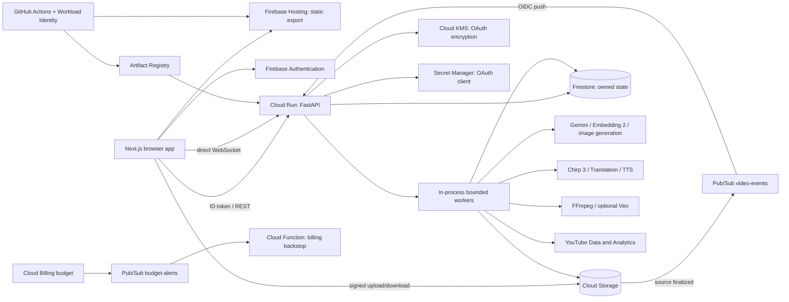
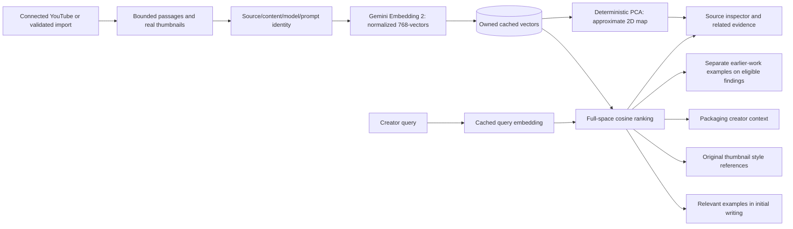
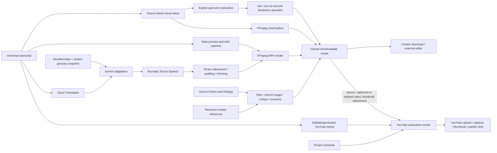
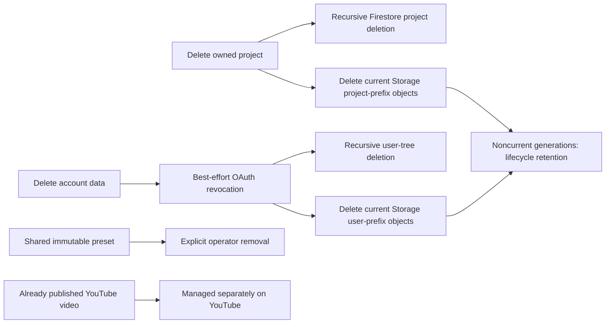

# Resonance architecture and flows

These diagrams describe current source paths. Workers execute in the Cloud Run API
process; they are not separately deployed services. [Architecture](../architecture.md)
provides the implementation boundaries and validation scope.

## Deployment



BigQuery datasets and unused worker subscriptions/accounts are absent from current Terraform.
Only the transcription push subscription remains; channel analytics use Firestore. Cloud
cleanup status is in [HANDOFF.md](../current-progress/HANDOFF.md). Regions: infrastructure/Veo `us-central1`,
Chirp `us`, Gemini configurable `global` by default.

## Upload and review

```mermaid
sequenceDiagram
    actor Creator
    participant UI as Studio
    participant API as FastAPI
    participant GCS as Storage
    participant PS as Pub/Sub
    participant STT as Chirp 3
    participant Review as Nine Gemini reviewers
    participant Rubric as All-rubric review
    participant Editor as Editor
    participant Check as Footage adjudicator
    participant FS as Firestore
    Creator->>UI: Upload a video
    UI->>API: Request owned upload session
    API-->>UI: Signed URL and asset ID
    UI->>GCS: Direct upload
    GCS->>PS: Source object finalized
    UI->>API: Complete asset
    PS->>API: OIDC push
    API->>FS: Converge on one atomically created job
    API->>STT: Batch recognition in us
    STT-->>API: Words, times and speakers
    API->>FS: Save versioned transcript
    UI->>API: Start pinned analysis
    API->>Review: Chunked transcript, persona, brief, sampled frames
    opt Factual verification or more footage needed
        Review->>Review: Google Search / bounded frame and clip tools
    end
    Review-->>API: Structured findings, usage, sources and partial errors
    API->>API: Normalize quotes, spans and duplicate advice
    API->>Rubric: Whole transcript, all nine rubrics, sampled stills
    Rubric-->>API: Additional observations in existing dimensions
    API->>Editor: Consolidate all observations
    Editor-->>API: Keep, merge or drop; immutable originals
    API->>Check: Selected serious findings and actual footage
    Check-->>API: Confirm, downgrade, reject or reconcile
    API->>API: Attach eligible earlier-work examples
    API->>FS: Persist model metadata, findings, coverage and five-second bins
    API-->>UI: WebSocket progress, REST results
    Creator->>UI: Seek, accept, revise or dismiss finding
    UI->>API: Preview and render selected safe cuts / edit notes
    API->>GCS: Upload inactive rough-cut revision
    API->>FS: Derived transcript and cut map; no STT
    Creator->>UI: Preview then activate or discard
    UI->>API: Re-review active revision
    API-->>UI: Compare aligned before/after runs; retain uncompared issues
```

Job idempotency is separate from provider retry safety. STT saves operation names and resumes
polling without submitting again. One ambiguous-submission resubmit is allowed; exactly-once
billing is not guaranteed. Interest prediction runs alongside reviewers; optional channel
retention calibration blends only the baseline on compatible curve reads.

## Creator retrieval



Similarity is relevance, not factual support. Text-plus-title/image embeddings are not
image-only embeddings. Heatmap reviewers and draft inline alternatives do not currently
retrieve this library. Precomputed preset installation skips new embedding calls.

## Media, packaging and publishing



Visual inserts are downloadable supplementary assets; they are not spliced into the source
or selectable as a finished source-video revision. Generated footage
has a bounded paid path; current live verification is recorded in HANDOFF.md. Publishing remains a separate
creator action and requires a real connected YouTube account. Packaging does not assemble
inserts; the rough-cut path can place selected existing inserts. Drafts cross-post synchronously
to Substack/Medium/Reddit through their providers, separately from YouTube publication.

## Deletion



The current Storage adapter does not explicitly purge noncurrent generations. Shared
presets and remote publications intentionally have different lifecycle owners.
